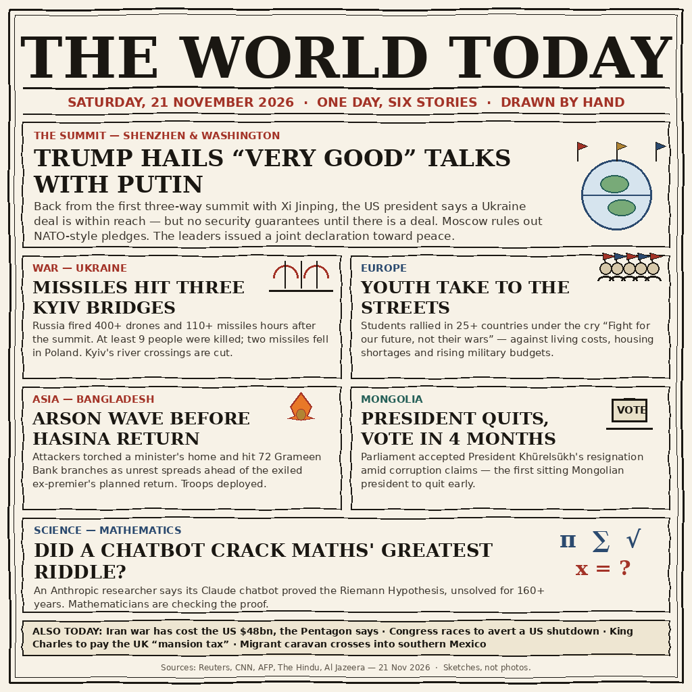

# The World Today — Saturday 21 November 2026

[](https://make.fun/bounty/news-image-20261121)
[](https://make.fun/bounty/news-image-20261121)
[](https://make.fun/bounty/news-image-20261121)

Entry for the [make.fun bounty "Sum up 21 November's world news in one image"](https://make.fun/bounty/news-image-20261121).

A hand-drawn newspaper front page for Saturday 21 November 2026, drawn
from scratch in Python with Pillow — no network, no stock photos, every
line and letter computed by `main.py`.



## The day's news

- **The summit** — Trump, Xi and Putin's first three-way meeting in
  Shenzhen ends with a joint "Declaration toward Peace"; back in
  Washington, Trump calls his talks with Putin "very good" but holds back
  security guarantees for Ukraine until there is a deal.
- **War in Ukraine** — Hours after the summit, Russia fires 400+ drones
  and 110+ missiles at Ukraine; three Kyiv bridges are hit, at least 9
  people are killed, and two missiles fall in Poland.
- **Europe** — Young people rally in 25+ countries under the cry "Fight
  for our future, not their wars", against living costs, housing
  shortages and rising military budgets.
- **Bangladesh** — An arson wave hits a minister's home and 72 Grameen
  Bank branches as unrest spreads ahead of Sheikh Hasina's planned return.
- **Mongolia** — Parliament accepts President Khürelsükh's resignation;
  an election is due within four months.
- **Science** — An Anthropic researcher says the Claude chatbot proved
  the Riemann Hypothesis; mathematicians are checking the proof.
- **Also today** — The Iran war has cost the US $48bn, the Pentagon says;
  Congress races to avert a US shutdown; King Charles will pay the UK
  "mansion tax"; a migrant caravan crosses into southern Mexico.

Sources: Reuters, CNN, Kyiv Independent, AFP, The Hindu, Al Jazeera,
Firstpost, Bernama.

## Run it

```sh
MAKEFUN_OUTPUT_DIR=out python3 main.py
```

Writes `out/entry.png` (1024×1024 PNG, well under 1 MiB). The program
is deterministic: two runs produce byte-identical output. Standard
library plus Pillow, using the DejaVu fonts shipped with the system.

## License

MIT — see [LICENSE](LICENSE).
